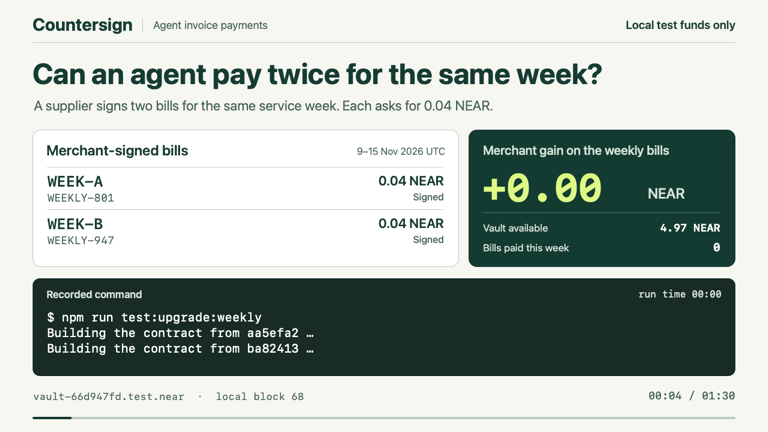

# Countersign

Countersign pays merchant invoices from a NEAR vault. An agent can request payment for an invoice ID. For a supplier enrolled in weekly billing, even two valid signatures can authorize only one payment for the same service week.

**[Open the recorded Demo café](https://pradeeppilotdev.github.io/countersign/)** — explore the weekly crash/retry and a separate public-testnet café run, with original records and explorer receipts. **Recorded demo: no new payments, wallet connections or live AI calls.**

## Two signed bills, one payment

1. A merchant signs two different invoices for **0.04 NEAR each** under the same weekly agreement. The agent submits both.
2. The vault settles one bill and blocks the other. We kill the payment worker after the transfer, while its last saved state is still `claimed`.
3. Fresh workers retry both invoices. The merchant has received **0.04 local test NEAR** in total. The retries add **0.00**.

[](docs/demo/weekly-payment.mp4?raw=1)

[90-second narrated replay of the terminal run (MP4)](docs/demo/weekly-payment.mp4?raw=1) · [Attack results and recorded balances](docs/attack-results/README.md)

**Try it from an agent.** Connect a local MCP client to a disposable café vault, request both signed bills by ID, and inspect the vault receipt. [MCP setup and crash test](mcp/README.md)

## Quick start

### Try the demo café

Complete the [local setup](docs/local-guide.md#quick-start), then start the local app with `COUNTERSIGN_PORT=4417 npm run dev` and open
[Demo café](http://127.0.0.1:4417/#demo). Leave `COUNTERSIGN_NETWORK` unset (or set it to `local`).

1. **Open the café** to create a separate agent vault, three suppliers with pinned signing keys and payouts, a 0.5 NEAR payment cap, a 1.2 NEAR daily budget (rolling 24 hours), and a weekly Milk Co service. Rules expire after 120 minutes.
2. **Receive today's invoices**, then **Pay all**. Signed bills arrive in shuffled order; the existing vault rules decide which payments settle. Fixture proposals are the default, with no model calls.
3. Review **Supplier ledger**: each supplier's live balance increase, paid invoice count, and signed on-chain receipts. The scam payee's live balance increase remains zero. Initial account funding is excluded. **Agent payments** shows the payment outcomes and reasons; **Rejected at intake** shows the tampered signature rejection.
4. **Ask Dave why** opens the floating panel with “How is my agent doing?”. Without a model key, Dave shows the existing no-key message.

Receive again for fresh invoice IDs. **Top up vault (+5 test NEAR)** adds exactly 5 to the vault's available funds. It does not raise the daily budget (rolling 24 hours): once that is spent, the café says so and later bills stay blocked until earlier payments are 24 hours old, or you reset. **Reset café** stops the old local chain and moves the entire agent directory to `work/agent-vault.bak-<timestamp>-<suffix>` before starting fresh; it never deletes the old records. If an agent vault already exists, use reset to preserve it before setup. Keys remain in ignored `work/` files and never reach the browser. Café routes and navigation are disabled on other networks.

Receipts show contract state, attempt IDs, and signed payload hashes; the shared CLI transport does not retain transaction hashes. Supplier identities use the existing merchant IDs (`Bean-Co`, `Milk-Co`, `Pastry-Co`) in Agent payments and Ask Dave, with friendly names on the café cards.


**Run it on GitHub.** Open the *Race two signed bills, crash the worker and retry* step in a verification run. It builds two contract revisions, starts a fresh local NEAR chain and checks the merchant’s balance. To run it yourself without installing tools, fork the repo and choose **Actions → Local payment verification → Run workflow**. A successful run publishes `weekly-payment-result` with the measured balances. [Verification runs](https://github.com/Pradeeppilotdev/countersign/actions/workflows/verify.yml)

**Run it on your computer.** Follow the [local setup](docs/local-guide.md#quick-start) in a full clone, then run this from the repo root.

```sh
npm run test:upgrade:weekly
```

Look for `PASS crash` and `PASS weekly`. Either bill can win. The merchant balance must increase by 0.04 once, with 0.00 extra on retry. The command prints the path to your own `result.json`.

If a supplier corrects a bill before reservation, the owner can transfer that week's claim to the exact signed replacement. Run `npm run test:weekly:correction` after the local build to race a 0.03 correction against the original 0.04 bill and crash the paying worker in each order. [Owner commands](docs/local-guide.md#one-payment-per-service-week)

## What runs

The demo executes native NEAR transfers on a disposable local chain. It uses fixed agent proposals so anyone can reproduce it without a model key. The optional NEAR AI Cloud adapter receives structured invoice fields and can propose only `request_payment({invoice_id})`. The vault checks the merchant signature, payout, spending limits and service week, and records settlement from the transfer callback.

**Hackathon tracks** · AI Security & Defense (primary), Agent Economy (secondary). Built during NEAR HACKATHON with Rust NEAR SDK, TypeScript, Node SQLite, near-workspaces and AI-assisted development. [Official tracks](https://nearhackathon.com/#tracks)

[Local payment desk, contract and operator guide](docs/local-guide.md)

The local desk opens on **Agent payments** at http://127.0.0.1:4317/#agent-payments on every network. Choose **Demo café** from the sidebar to try the demo. In Agent payments, import a supplier's signed bill, request payment and read the receipt (needs a local agent vault with a policy and a pinned supplier key). The page calls the same functions as `agent:desk import`, `run` and `resume` and adds no payment logic. The manual payment desk and dry-run 1Click lab are under **Tools**. See [Agent payments in the desk](docs/local-guide.md#agent-payments-in-the-desk).

Ask Dave also runs in the desk: open http://127.0.0.1:4317/#ask-dave (needs a local agent vault: npm run agent:desk -- init). Its questions read `work/agent-vault` (or `COUNTERSIGN_AGENT_DIR`), while the manual payment desk uses `work/local-vault` (or `COUNTERSIGN_SANDBOX_DIR`). The page and each answer identify the source account. Standalone account checks show their selected network separately; questions always read the local agent vault.

## Public testnet vault

The opt-in [testnet guide](docs/testnet.md) covers atomic deployment and the café
verification below. The app, agent desk and local tests continue to use the local sandbox.

Install the isolated tooling with `npm ci --prefix testnet --ignore-scripts`; run its
offline checks with `npm --prefix testnet test`. Live commands use
`COUNTERSIGN_NETWORK=testnet npm --prefix testnet run vault -- <command>` or
`COUNTERSIGN_NETWORK=testnet npm --prefix testnet run cafe`, as detailed in the guide.

## Live on testnet

Dave’s café ran on **10 November 2026** using fixture proposals and **zero live model calls**. The owner [funded 2 test NEAR](https://testnet.nearblocks.io/txns/EH15gCKNAbSx4TsGcvuDwCMUjXxMgyeYg8KV9hnphw6d) and [set the policy](https://testnet.nearblocks.io/txns/DZvaAfBUJGMoHtUNQmT3pDRxAaThYsQ9QEzPXiZ7n3VX): 0.5 per payment, 0.8 rolling daily budget, 0.01 minimum, four-hour expiry. The executor paid signed bills without per-invoice owner approval. All rejections below came from submitted contract transactions.

| Outcome | Transaction / NearBlocks | Exact result |
|---|---|---|
| Signed bill under policy | [`C5ok2A2DsLrkoJ7D89dQddmg9Y95qn9w7m78VcE1k5Ag`](https://testnet.nearblocks.io/txns/C5ok2A2DsLrkoJ7D89dQddmg9Y95qn9w7m78VcE1k5Ag) | `Settled`; merchant +0.4 NEAR once; replay +0. |
| Tampered payee | [`UMJQ9TZzhuAZbvtYyRjKbSi5HzKhN6gzhMyAuzAHUSD`](https://testnet.nearblocks.io/txns/UMJQ9TZzhuAZbvtYyRjKbSi5HzKhN6gzhMyAuzAHUSD) | `Smart contract panicked: invalid merchant signature` |
| Same bill, new invoice ID | [`JMJyVdSeSyi6kyq48zBcHesF1diquLk7GDrVaQXtVrU`](https://testnet.nearblocks.io/txns/JMJyVdSeSyi6kyq48zBcHesF1diquLk7GDrVaQXtVrU) | `Smart contract panicked: merchant bill already used` |
| Daily budget exceeded | [`BD2wAqJz62Yb9ZfGA23KHdQ7pzyoj9749J5hDKWWmWy`](https://testnet.nearblocks.io/txns/BD2wAqJz62Yb9ZfGA23KHdQ7pzyoj9749J5hDKWWmWy) | `Smart contract panicked: rolling daily budget exceeded` |
| Kill after reserve; restart and resume | [`C1AY2bgfKehYPsKyN6rRSkpwKDjpyE6BkDyd9YFKMswG`](https://testnet.nearblocks.io/txns/C1AY2bgfKehYPsKyN6rRSkpwKDjpyE6BkDyd9YFKMswG) | `Settled`; merchant +0.3 NEAR once; replay +0. |

For the crash case, we confirmed [reserve](https://testnet.nearblocks.io/txns/79ZGUuH58FXGrb4ofRghDWZ8dNfdux8a3vjsoDLDbq8d), killed the worker with SIGKILL, and resumed the same durable attempt in a fresh process. Merchant credit totaled **0.7 NEAR**, with **zero extra on replay** and **1.3 NEAR** remaining in the vault budget. After the original RPC’s interruption, we switched to FastNEAR and [renewed only the expired policy deadline](https://testnet.nearblocks.io/txns/9xvdKg1npdD7NRaGRxyb7zXMKxV1fjuTTsbMP3hvEQUN), preserving its limits and 0.4 NEAR usage. [Full public receipts, balance snapshots and crash evidence](docs/testnet-cafe.json) · [Reproduce the café run](docs/testnet.md#daves-café-on-testnet).
